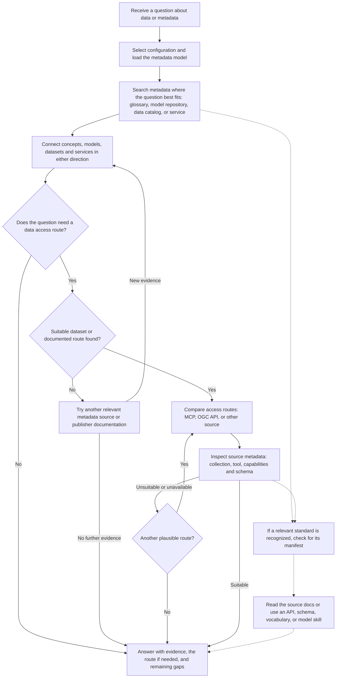

# Metadata skill

`metadata` helps AI agents find the metadata they need to answer a data question. It starts where the question is most likely to be described: a glossary, model repository, data catalog, or service description. It connects those findings to datasets and access routes such as MCP, OGC API, or downloads, then checks the source's own metadata. It is for **understanding existing resources**, not authoring, publishing, or certifying them.

> **Conceptversie / draft.** Deze skill helpt metadata in datacatalogi te lezen en gegevens, diensten en modellen aan elkaar te verbinden. De skill is geen standaard of conformiteitstoets. See [DISCLAIMER.md](./DISCLAIMER.md).

## What it does

- Searches relevant metadata sources using the user's terms, official labels and related terms. It can start with a concept or model and work toward datasets, or start with a dataset or service and trace back to its definitions.
- Compares documented access routes and checks their own metadata: MCP tool and resource descriptions, OGC API collections and queryables, or a download's schema and data dictionary. See the [source discovery guide](./skills/metadata/references/source-discovery.md).
- Reads source documentation directly or uses an [interpretation skill](./skills/metadata/references/handoffs.md) for a specific question about an API, schema, vocabulary, or model. The [metadata model](./skills/metadata/references/conceptual-model.md) and [standards](./skills/metadata/references/standards.md) help interpret the evidence; recognizing a standard is not required to find or inspect a source.

## Expected flow

The [standards manifest workflow](./skills/metadata/references/standards-manifests.md) discovers skills, tools, services and documentation. A listing is a lead, not permission to install or run anything.

For **“Welke BGT-objecten kunnen verhard zijn?”**, start with an IMGeo glossary or model catalog rather than a dataset title search. Use `verharding`, `verhard` and `fysiek voorkomen` as search leads, then check the versioned object types, attributes and value lists. If the user needs actual records, find the dataset or service that implements that model and verify its collection, fields and filters. A glossary match is not a service field or a filter.

An interpretation skill can explain what a source records and how to query it. If the question requires domain judgment beyond the metadata, recommend consulting a domain expert and explain what they need to assess. For example, an OpenAPI skill can check whether pavement type is recorded or filterable; a hydrologist can assess whether it helps predict water accumulation. This skill does not contact anyone.

## Configure the model and sources

Use the [built-in metadata model](./skills/metadata/references/conceptual-model.md), or select a local file or published artifact as the interpretation model. Configure discovery sources separately: the agent can look for records, domain models, vocabularies, dataset distributions and standards manifests. See the [configuration contract](./skills/metadata/references/configuration.md) for fields, precedence and fallbacks. Without a profile, the built-in model is used and no discovery sources are preconfigured.

**Modeldesk experiment:** Tell the agent to use [`modeldesk.experimental.json`](./skills/metadata/examples/config/modeldesk.experimental.json), or copy it to `metadata.config.json` in your workspace root. Inspired by [skills-mim PR #1](https://github.com/Geonovum-labs/skills-mim/pull/1/changes), the profile searches the [Geonovum Modeldesk catalog](https://catalog.modeldesk.io/geonovum) for metadata, domain models, vocabularies and a metadata model if published there. The profile uses the built-in model until a specific metadata-model artifact is selected. Modeldesk working versions are not official releases, and a catalog entry does not establish a dataset-to-model binding.

## Install locally

The only skill is [`skills/metadata/`](./skills/metadata/). It needs no runtime dependencies. Keep the whole `metadata` directory intact, including references and examples.

- **VS Code / GitHub Copilot:** copy or link the skill directory to `.github/skills/metadata` in the workspace where you want to use it.
- **Claude Code:** from the repository root, launch `claude --plugin-dir .` to try the local plugin, or copy the skill directory into `.claude/skills/metadata` in your workspace.
- **Cursor:** copy the skill directory into `.cursor/skills/metadata` in your workspace, or use the plugin manifest with your plugin distribution workflow.

The repository includes Claude, Cursor and generic plugin manifests, matching the companion repositories' packaging convention. This draft is not listed in a marketplace.

Install optional companions separately from [skills-mim](https://github.com/Geonovum-labs/skills-mim) and [skills-nl-sbb](https://github.com/Geonovum/skills-nl-sbb) if needed. Install MIM using its upstream instructions so that its shared reading resources remain available. No companion is required for basic triage.

Try: “Which datasets provide groundwater-level observations for this area and period? Find a suitable access route and check which station, timestamp and measurement fields it documents.” Or start offline with the [synthetic worked example](./skills/metadata/examples/catalog/worked-example.md).

## Repository

| Location | Purpose |
| --- | --- |
| [`skills/metadata/SKILL.md`](./skills/metadata/SKILL.md) | Entry point and evidence workflow |
| [`references/`](./skills/metadata/references/) | Conceptual model, configuration, standards manifests and interpretation skill routes |
| [`examples/catalog/`](./skills/metadata/examples/catalog/) | Runnable reading scenario with local fixtures |
| [`examples/config/`](./skills/metadata/examples/config/) | Modeldesk experiment and offline configuration fixtures |
| [`evals/`](./skills/metadata/evals/) | Behavioral smoke cases and scoring instructions |
| [`docs/delivery-plan.md`](./docs/delivery-plan.md) | Creation plan, design decisions and publication checklist |
| [`publiccode.yml`](./publiccode.yml) | Software metadata for the proposed repository |

Licensed under the [EUPL-1.2](./LICENSE). Standards and companion projects keep their own licenses.
